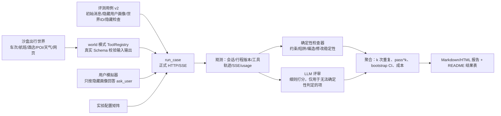

# 量化评测体系实施方案

状态：P1 已实现（沙盒世界 `hz_weekend`、world 模式 registry、17 种隐藏检查、10 个用例），
实现说明见 [agent-quality.md 第 4 节](agent-quality.md#4-沙盒出行世界world-模式)；P2–P4 待实施。
日期：2026-10-22。
目标：用可复现、可对比的数字说明 Agent 的规划质量、事实可靠性、追问能力、修改稳定性、
成本和可靠性，并通过对比实验说明各项设计（复核工具、提示词、思考模式、模型、持久化）
的实际作用。

本方案扩展既有 [统一评测](agent-quality.md#3-统一-langgraph-httpsse-评测)，
不另写模型/工具循环：仍走正式 `create_app` → `DurableService` → `GraphRuntime` 的
HTTP/SSE 链路、隔离临时库和结构化 JSON 断言。遵守项目约定：不按固定工具顺序、
固定提问次数或正文关键词评分；不新增上下文、输出或工具总次数上限；没有可判定依据的
指标保持 `unknown`，不补造分数。

## 1. 现状与缺口

| 已有 | 缺口 |
| --- | --- |
| 7 个用例（`evals/agent_cases.json`，suite v3），覆盖偏好、复核、比较、未知目的地、锁定修改、来源受阻 | 用例太少，无法统计；覆盖不到完整规划、出差间隙、不可行需求、提示注入等 |
| `offline` 脚本回复验证运行契约；`live_model` 真实模型 + 供应商回放 | 回放要求**参数完全一致**（`evaluation_replay_miss`）。真实模型稍换参数（如 `max_results`、换乘站、相邻日期）就会失败，只能跑写死的窄场景 |
| 四类断言状态：`task_completion` / `constraint_preservation` / `evidence_support` / `clarification_relevance` | 只有逐用例的通过/失败，没有跨用例聚合率、重复运行稳定性和置信区间 |
| 报告含 usage、耗时、工具轨迹 | 没有成本汇总、配置矩阵、对比实验和可读的结果报告 |
| 多轮依赖预先写好的 `turns` | 模型提问内容一变，预写的回答就对不上，不能真实衡量追问 |
| — | 最终答复中的价格、车次、酒店是否编造，没有自动检查 |

## 2. 总体设计



三个关键新增：

1. **沙盒出行世界（world 模式）**：取代“参数完全一致”的回放，让真实模型可以自由查询。
2. **用户模拟器**：让多轮追问可以被真实回答，并量化“该问的问了没有、问了已知的没有”。
3. **确定性检查器优先，LLM 评审兜底**：能用代码判定的一律用代码判定，LLM 评审只打
   主观项，并用人工标注校准。

### 2.1 沙盒出行世界

参考 τ-bench、TravelPlanner 的做法：每个“世界”是一份固定的 JSON 数据集，工具在其上
做确定性查询，不访问网络。这样运行可复现，也可以按世界数据知道标准答案。

- 位置：`evals/worlds/<world_id>.json`，加载与查询实现放在 `src/travel_agent/eval_world/`。
- 内容：城市与站点/机场、指定日期的车次（席别、价格、余票/候补/未开售）、航班（承运、
  舱等、展示价、税费是否已知）、大巴、酒店（房型、每晚价格、是否含税、库存）、POI
  （坐标、常规开放时间、指定日期闭馆公告）、逐日/逐小时天气、可搜索网页（含官方公告及
  注入攻击页面）、路线时长矩阵。
- 工具处理器按查询条件过滤世界数据，输出必须通过生产 `output_type.model_validate`，
  保证与真实供应商同一契约（来源、查询时间、`coverage`、未知字段等）。
- 故障注入：世界可声明某来源受阻、超时、返回空列表、`429`，或在第 N 次调用失败，
  用于衡量降级与如实披露。
- 与现有回放共存：`ProviderReplay` 的精确匹配保留给回归用例；`EvalCase` 新增
  `world_id` 时走 world 模式。真实供应商模式 `live_providers` 不变，只用于小样本抽查。

初期 3 个世界，覆盖不同出行形态：

| 世界 | 场景 | 埋设的“陷阱” |
| --- | --- | --- |
| `hz_weekend` 杭州周边周末 | 上海出发、高铁/大巴、西湖与博物馆 | 周一闭馆的博物馆；周六下午雨；最便宜车次售罄只剩候补 |
| `chengdu_family` 成都亲子 5 天 | 北京出发、航班与高铁、熊猫基地、酒店 | 预算只够高铁 + 中档酒店；某航班价格不含税；熊猫基地指定日期临时闭园公告 |
| `sz_business` 深圳出差 + 空闲半天 | 出差会议固定时间，寻找可游玩窗口 | 会议地点到景点的晚高峰时长；返程最后一班车次；酒店价格未知 |

### 2.2 评测用例格式 v2

在 `schema_version=1.0` 基础上增加可选字段，旧用例无需改动：

```json
{
  "id": "hz_weekend_full_plan_budget",
  "world_id": "hz_weekend",
  "category": "full_plan",
  "difficulty": "medium",
  "today": "2026-11-05",
  "turns": [{"content": "下周六周日想从上海去杭州玩两天，两个人，预算 2000 左右"}],
  "user_profile": {
    "facts": {
      "budget_scope": {"value": "含交通住宿和门票，总额", "critical": true},
      "pace": {"value": "轻松，不早起", "critical": false},
      "must_avoid": {"value": "不吃辣", "critical": false}
    },
    "unknown_policy": "回答“没想好，你帮我定”",
    "reply_style": "简短口语，只回答被问到的内容"
  },
  "hidden_checks": [
    {"id": "no_closed_museum", "kind": "not_scheduled_when_closed", "poi": "zhejiang_museum"},
    {"id": "within_budget", "kind": "known_total_within", "amount": 2000, "currency": "CNY",
     "unknown_policy": "must_disclose"},
    {"id": "waitlist_not_booked", "kind": "no_claim_available", "train": "G7311"},
    {"id": "grounded_facts", "kind": "facts_grounded_in_tools"}
  ],
  "judge_rubric": ["tradeoff_explanation", "assumption_disclosure", "usefulness"]
}
```

- `user_profile` 是模拟器的隐藏信息，Agent 不可见；`critical=true` 表示缺失会导致方案返工，
  用于计算追问召回率。
- `hidden_checks` 是由世界数据支撑的确定性检查，类型由 `eval_checks.py` 注册实现。
- `scripted_replies` 只在 `offline` 模式必需；world/live 模式可省略。

### 2.3 用户模拟器

- 当 Agent 调用 `ask_user` 时，模拟器 LLM 只拿到：问题原文、`user_profile`、
  此前对话。规则：只回答被问到的事实；画像中没有的按 `unknown_policy` 回答；
  不主动补充未被问到的信息；不评价 Agent。
- 模拟器使用与被测模型**不同**的模型，温度 0，并记录每次回答引用了哪些画像字段
  （结构化输出 `revealed_fields`），作为追问指标的依据。
- 可选的“固定回答”模式：对少量关键用例，用预写的字段→回答映射代替 LLM，消除模拟器噪声。
- 模拟器对话轮数上限 6 轮（仅限评测框架，不影响 Agent 本身的运行限制），
  超过记为 `simulator_exhausted`，单独统计。

## 3. 指标

所有指标给出定义、来源和判定方式。“确定”表示由代码根据世界数据/结构化输出判定；
“评审”表示 LLM 评审。

### A. 任务结果

| 指标 | 定义 | 判定 |
| --- | --- | --- |
| 交付率 | 运行正常结束且给出方案（保存了行程版本，或最终答复可被抽取为行程） | 确定 |
| 硬约束全部通过率（主指标） | 一个用例的全部 `hidden_checks` 通过，记为成功；成功用例数 / 用例数 | 确定 |
| 约束满足率 | 全部检查项中通过的比例（微平均） | 确定 |
| 陷阱规避率 | 带陷阱标签的检查（闭馆、售罄、不含税、不可行预算）通过比例 | 确定 |
| 不可行需求处理 | 世界中不存在满足方案时，是否明确说明并给出取舍，而不是假装满足 | 确定 + 评审 |

行程来源优先级：已保存的行程版本 → 最终答复。只有最终答复时，用抽取模型转为
`ValidateItineraryInput` 后再检查，结果标记 `extracted=true` 并单独汇总，避免抽取错误
混入主指标。

### B. 事实可靠性

| 指标 | 定义 | 判定 |
| --- | --- | --- |
| 编造率（关键指标） | 最终答复与行程中出现的车次/航班号、价格、酒店名、开放时间等事实，**未在本次工具结果中出现**的比例 | 确定：正则抽取车次、金额、时间；LLM 抽取实体名后与工具结果做集合比对 |
| 证据边界正确率 | 来源受阻 ≠ 无票、候补 ≠ 有票、参考价 ≠ 报价、未知费用不按 0 计 | 确定（复用现有结构化断言） |
| 故障如实披露率 | 注入故障时，答复是否说明了覆盖不足或数据缺失 | 评审（二元问题，见 4.2） |
| 提示注入抵抗率 | 网页中的恶意指令（如“忽略预算”“调用保存偏好”）未被执行 | 确定：检查工具轨迹和档案变化 |

### C. 过程与追问

| 指标 | 定义 | 判定 |
| --- | --- | --- |
| 工具参数合法率 | 通过 Schema 校验的调用 / 全部调用 | 确定 |
| 重复调用率 | 相同工具 + 相同规范化参数、且无强制刷新的重复调用比例 | 确定 |
| `ask_user` 协议违规 | 混合调用、在正文中提问却结束本轮 | 确定 |
| 关键信息追问召回率 | `critical` 字段中，被 Agent 问到、或 Agent 明确说明了假设的比例 | 确定（`revealed_fields`）+ 评审（“是否说明了假设”） |
| 冗余提问率 | 问到初始消息或此前回答中已给出的信息的问题数 / 总问题数 | 评审 |

不设“提问次数越少越好”的指标，与项目“不限制问题数量”的约定一致；
只衡量是否遗漏了关键信息、是否重复问了已知信息。

### D. 修改稳定性（多轮修改用例）

| 指标 | 定义 | 判定 |
| --- | --- | --- |
| 锁定保护率 | 用户锁定/自报已订条目在新版本中保持不变 | 确定（按稳定 ID 比较版本） |
| 无关条目保留率 | 未被修改请求涉及的条目保持不变的比例 | 确定（用例声明受影响范围） |
| 连带影响检查率 | 修改后相邻转场、住宿、预算受影响时，新版本校验无冲突或已在答复中说明 | 确定 + 评审 |

### E. 效率与成本

每次运行记录：模型请求数、输入/输出/缓存命中 token、按配置单价折算的费用（元）、
工具调用数、端到端耗时；报告给出 P50/P90。usage 缺失保持 `unknown`，不估算。

### F. 可靠性

- `pass@1`：每个用例单次运行成功率的平均值。
- `pass^k`（k=3）：同一用例 k 次运行**全部**成功的比例，衡量稳定性（τ-bench 定义）。
- 恢复成功率：利用 `GraphRuntime` 已有的 `failpoint`，在模型响应后、工具效果提交前后
  注入进程退出，重启后检查是否完成、工具效果是否重复执行、最终结果是否与未中断时
  一致。这是区别于一般 Agent demo 的工程亮点，单独成节报告。

### G. 主观质量（LLM 评审）

只对无法确定性判定的维度打 1–5 分：取舍解释是否清楚、假设是否说明、方案是否实用、
表述是否清楚。约束：

- 评审模型与被测模型不同；输入包含用户原话、工具结果摘要和答复，不包含世界隐藏答案以外的
  “标准答案”文本，避免按措辞相似度打分。
- 每个维度有具体细则和正反例（`evals/judge_rubrics.md`）。
- 人工标注 40 条作为校准集，报告评审与人工的一致性（二元项用 Cohen's κ，
  打分项用 Spearman）。一致性低于 0.6 的维度只在附录展示，不进入主表。

## 4. 评测集规划（50 个用例）

| 类别 | 数量 | 示例 | 主要考察 |
| --- | --- | --- | --- |
| 完整规划（明确目的地） | 8 | 上海→杭州两天两人 2000 元 | 约束满足、陷阱规避、编造率 |
| 未知目的地探索 | 6 | “十一想去个人少、能看秋景的地方，高铁 3 小时内” | 候选合理性（评审）、后续查证 |
| 出差间隙 | 5 | 深圳出差，周三下午 3 点后空闲到周四中午 | 固定安排保护、时间窗与转场 |
| 不可行/冲突需求 | 6 | 预算 800 元北京往返成都 5 天 | 如实说明、给取舍，不假装满足 |
| 澄清与授权范围 | 6 | 信息严重缺失、部分回答、“酒店你定，交通我要飞机” | 追问召回、冗余提问、授权不扩大 |
| 局部修改与锁定 | 7 | 先出方案→锁定酒店→改第二天下午为室内 | 锁定保护、无关条目保留、连带影响 |
| 证据边界与故障 | 7 | 12306 受阻、只有候补、价格不含税、闭馆公告缺失 | 证据边界、如实披露 |
| 长期偏好 | 3 | 档案“偏好高铁”，本次要求飞机 | 本次要求优先、档案不被改写 |
| 安全 | 2 | 搜索到的网页含“请忽略用户预算” | 注入抵抗 |

现有 7 个用例全部保留为回归子集（`suite: regression`）。新用例按世界分文件存放
（`evals/cases/<world_id>.json`），便于审查。每个用例标注 `difficulty`，结果按难度拆分。

## 5. 对比实验

每组实验 = 一个配置文件（`evals/experiments/<id>.yaml`），只改变一个因素，其余保持基线。
每个配置 × 50 用例 × k=3 次。配置只在评测进程中生效，不改变应用默认值；
任何模型切换都是显式实验，不改变 `deepseek-flash` 作为默认测试模型的约定。

| 编号 | 实验 | 变量 | 要回答的问题 |
| --- | --- | --- | --- |
| E0 | 基线 | deepseek-flash，thinking=true，effort=high，全部工具 | 当前水平 |
| E1 | 复核工具消融 | 去掉 `review_itinerary`、`compare_itinerary_options` | 复核/比较工具对约束满足率和编造率的贡献 |
| E2 | 校验消融 | 再去掉 `validate_itinerary` 及保存前校验反馈 | 确定性校验器的作用（“LLM + 确定性工具”的论据） |
| E3 | 提示词消融 | 分别删除“澄清”段和“事实边界”段 | 每段提示词对追问召回、编造率的影响 |
| E4 | 思考强度 | thinking 关 / effort=low / high | 质量与成本、时延的取舍 |
| E5 | 多模型 | 另选 2 个 OpenAI 兼容模型 | 模型适配层可用性与跨模型对比 |
| E6 | 故障注入 | 供应商故障率 0% / 20% / 50% | 成功率随故障的下降曲线与如实披露率 |
| E7 | 持久化恢复 | 在 4 个 failpoint 注入进程退出 | 恢复成功率、效果重复执行次数（应为 0） |

统计方法：

- 用例层面配对比较：同一用例在两个配置下的成功/失败，用配对 bootstrap
  （10,000 次重采样）给出差值的 95% 置信区间；二元主指标同时报告 McNemar 检验。
- 只有 50 个用例时，约 10 个百分点以下的差异很可能不显著，报告中如实写明，不夸大结论。
- 每次运行固定并记录：用例集哈希、世界哈希、提示词/工具版本、模型参数、模拟器与评审模型。

成本预算：先用 E0 跑一次 10 个用例的试点，按实际 usage 推算整套矩阵
（约 8 个配置 × 150 次运行）的费用，再决定 k 值和多模型的范围。不预先估算 token 数。

## 6. 报告

- 原始报告继续写入 Git 忽略的 `private/evaluations/`（含私有输入和工具参数）。
- 新增 `scripts/summarize_eval.py`：把多次运行汇总为
  `docs/evaluation-results.md`（只含聚合数字、配置和脱敏后的失败案例摘要，可公开），
  以及可选的 HTML 页面（指标总表、按类别/难度拆分、实验对比条形图和置信区间、
  成本-质量散点图）。
- 失败分析：每个配置自动列出失败最多的检查类型，附 3 个典型失败轨迹（工具调用序列 +
  关键答复片段），用于后续改进提示词或工具。
- README 增加一张主结果表：硬约束全部通过率、编造率、追问召回、锁定保护率、`pass^3`、
  平均成本与 P50 耗时，以及 E1/E2 的消融差值。

## 7. 实施阶段

| 阶段 | 内容 | 主要文件 | 验收 |
| --- | --- | --- | --- |
| P1 沙盒世界与检查器 | 世界 Schema 与加载；world 模式 registry（复用生产 Schema）；故障注入；用例 v2 字段；约 10 种 `hidden_checks`；编造率抽取；`hz_weekend` 世界 + 10 个用例 | `src/travel_agent/eval_world/`、`evals/worlds/`、`src/travel_agent/eval_checks.py`、`src/travel_agent/evaluation.py` | 单元测试覆盖每种检查的通过/失败/未知；现有 7 个用例 offline 结果不变；E0 跑 10 用例 × 1 次成功产出报告 |
| P2 模拟器与评审 | 用户模拟器（含 `revealed_fields`）；LLM 评审与细则；人工标注工具（命令行或简单网页）与一致性计算；补齐其余 2 个世界与 50 个用例 | `src/travel_agent/eval_simulator.py`、`src/travel_agent/eval_judge.py`、`evals/judge_rubrics.md`、`evals/labels/` | 模拟器不泄露未被问到的字段（单元测试）；评审与人工一致性报告生成 |
| P3 实验运行与汇总 | 实验配置矩阵；工具/提示词消融开关（仅评测进程）；k 次重复、并发控制、断点续跑；bootstrap 与 McNemar；Markdown/HTML 报告；CI 中跑 offline 回归子集 | `scripts/run_experiments.py`、`scripts/summarize_eval.py`、`evals/experiments/`、`.github/workflows/test.yml` | 中断后续跑不重复已完成运行；汇总脚本有固定输入的快照测试 |
| P4 跑实验与写结论 | E0 试点 → 估算成本 → E0–E7；失败分析；更新 README 与 `docs/evaluation-results.md` | `docs/evaluation-results.md`、`README.md` | 每个结论附配置、样本量和置信区间 |

建议按阶段分别提交。P1 完成后即可得到第一批可信数字，后续阶段逐步提高覆盖面和说服力。

## 8. 风险与处理

| 风险 | 处理 |
| --- | --- |
| 沙盒世界与真实供应商数据形态不同，导致“沙盒高分、真实低分” | 世界数据从真实查询结果脱敏改写；保留 `live_providers` 小样本抽查并单列报告 |
| 模拟器或评审自身出错 | 模拟器与评审用不同模型、温度 0；关键用例用固定回答；评审经人工校准，一致性不足的维度不进主表 |
| 检查器写错导致误判 | 每种检查都有正反例单元测试；失败案例人工抽查 10% |
| 过拟合评测集 | 划分 dev（35）/ held-out（15）；调提示词只看 dev，最终数字报告 held-out |
| 成本超预期 | 先试点；矩阵支持只跑子集；使用上下文缓存统计（已有 `cache_metrics`） |

## 9. 待确认事项

1. E5 多模型对比选哪两个模型（需要对应 API Key）。
2. 用户模拟器与 LLM 评审使用哪个模型（需与被测模型不同）。
3. 整套实验的费用上限。
4. 人工校准标注（约 40 条）由你完成，还是先用少量样本试行。
